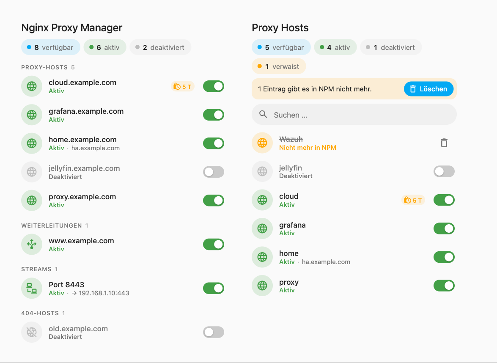
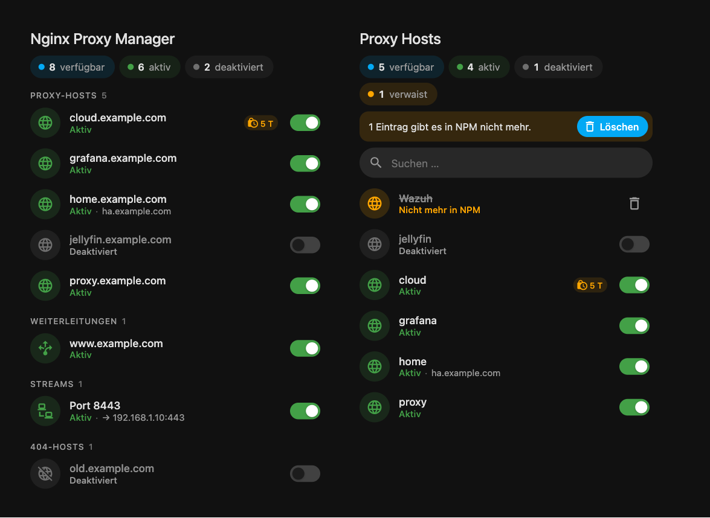

# NPM Card

A Home Assistant dashboard card for **Nginx Proxy Manager**: every host you configured in NPM, with its domain name and
a **switch to enable or disable it**. The header shows how many hosts are **available**, **active** and **disabled**.

Built on the switches of the [NPM Switches](https://github.com/InTheDaylight14/nginx-proxy-manager-switches)
integration (Marketplace / HACS): all hosts are discovered automatically, nothing to configure.




## Features

- One row per host: **domain name**, type icon, status and a **switch** that enables or disables the host in NPM.
- **Header counters**: available, active, disabled (plus unavailable, when a switch is unavailable).
  Tap a counter to show only those hosts.
- Proxy hosts, redirections, streams and 404 hosts, **grouped by type** (each type can be hidden).
- Hosts with several domains show the others in the second line (`+2 more`, or the full list).
- **Certificate warning**: a badge with the days left when a certificate expires soon (needs the certificate sensors of NPM Switches).
- **Clean up deleted hosts**: when a host was deleted in NPM, its entity stays in Home Assistant ("no longer provided
  by the npm_switches integration"). The card marks it as *orphaned* and offers administrators to delete it – per row
  or all at once.
- **Optional confirmation** before a host is disabled – useful for the host that serves Home Assistant itself.
- Search field, sort order, start filter, hidden domain suffix (`cloud.example.com` → `cloud`), per-host names and icons.
- Every element can be shown or hidden. Visual editor, German and English.
- Several NPM instances: filter by instance, the instance name is shown when more than one is in the card.

## Requirements

Install and set up the [NPM Switches](https://github.com/InTheDaylight14/nginx-proxy-manager-switches) integration.
In its options, turn on the host types you want to see (proxy hosts are on by default; redirections, streams and 404
hosts are off by default). For the certificate badge also turn on the certificate sensors.

<!-- ha-marketplace:exclude-start -->
## Installation

### Marketplace (Home Assistant 2026.11+) / HACS

[](https://my.home-assistant.io/redirect/marketplace_repository/?owner=benkrebs&repository=npm-card&category=plugin)

Or open **Settings → Marketplace**, add `https://github.com/benkrebs/npm-card` as a custom repository
of type **Dashboard**, install it and reload the browser. The Marketplace adds the dashboard resource for you.

On Home Assistant before 2026.11 use the
[HACS link](https://my.home-assistant.io/redirect/hacs_repository/?owner=benkrebs&repository=npm-card&category=plugin) instead.

### Manual

Download `npm-card.js` from the [latest release](https://github.com/benkrebs/npm-card/releases/latest),
copy it to `config/www/`, and add `/local/npm-card.js` as a dashboard resource of type **JavaScript module**.
<!-- ha-marketplace:exclude-end -->

## Quick start

```yaml
type: custom:npm-card
```

Without `entities` the card shows every switch of NPM Switches.

A typical configuration:

```yaml
type: custom:npm-card
title: Reverse Proxy
hide_domain_suffix:
  - example.com           # cloud.example.com → cloud
sort: disabled_first
confirm_disable: true
show_search: true
exclude_entities:
  - switch.npm_proxy_test_example_com
```

Pick hosts yourself, with your own names and icons (YAML):

```yaml
type: custom:npm-card
entities:
  - switch.npm_proxy_cloud_example_com
  - entity: switch.npm_proxy_home_example_com
    name: Home Assistant
    icon: mdi:home-assistant
    url: https://home.example.com/lovelace
  - switch.npm_stream_8443
```

## Options

| Option               | Default        | Description                                                                          |
| -------------------- | -------------- | ------------------------------------------------------------------------------------ |
| `title`              | `Nginx Proxy Manager` | Card title.                                                                   |
| `entities`           | –              | Switches to show (ids or host objects, see below). Empty = every NPM Switches switch. |
| `exclude_entities`   | –              | Switches to leave out of the automatic discovery.                                    |
| `host_types`         | all            | `proxy`, `redirect`, `stream`, `dead` (404 hosts).                                   |
| `devices`            | –              | NPM instances (device ids) to show. Empty = all.                                     |
| `show_header`        | `true`         | Show the header (title and counters).                                                |
| `show_title`         | `true`         | Show the title.                                                                      |
| `show_total`         | `true`         | Show the number of available hosts.                                                  |
| `show_enabled`       | `true`         | Show the number of active hosts.                                                     |
| `show_disabled`      | `true`         | Show the number of disabled hosts.                                                   |
| `header_filter`      | `true`         | Tapping a counter filters the list (tap again to show all).                          |
| `show_search`        | `false`        | Show a search field (domain, name, stream target).                                   |
| `show_icon`          | `true`         | Show the type icon (colored by state).                                               |
| `show_status`        | `true`         | Show "Active" / "Disabled" in the second line.                                       |
| `show_type`          | `true`         | Show the host type in the second line (hidden under group headings and when the card holds one type only). |
| `show_all_domains`   | `false`        | List every further domain instead of `+2 more`.                                      |
| `show_certificate`   | `true`         | Show a badge when the certificate expires within `cert_warning_days`, or has expired. |
| `cert_warning_days`  | `30`           | Days before expiry from which the badge is shown. Set `365` to always show it.       |
| `show_instance`      | `true`         | Show the NPM instance when the card holds hosts of more than one instance.           |
| `show_toggle`        | `true`         | Show the switch.                                                                     |
| `group_by_type`      | `true`         | Headings per host type when more than one type is shown.                             |
| `hide_domain_suffix` | –              | Domain suffixes removed from the shown name, e.g. `[example.com]`.                   |
| `sort`               | `name`         | `name`, `enabled_first`, `disabled_first`, `config` (order of `entities`; default when `entities` is set). |
| `filter`             | `all`          | Filter when the card loads: `all`, `enabled`, `disabled`, `orphaned`.                |
| `tap_action`         | `more-info`    | Tap on icon / name: `more-info`, `open` (open the domain in a new tab), `none`.      |
| `confirm_disable`    | `false`        | Ask "Disable?" before a host is disabled.                                            |
| `show_orphaned`      | `true`         | List entities of hosts that were deleted in NPM (struck through, with an *orphaned* counter). |
| `allow_delete`       | `true`         | Offer administrators to delete those entities (row button and "Delete all").         |
| `colors`             | see below      | Color per state: `enabled`, `disabled`, `unavailable`, `orphaned`.                   |

Colors accept Home Assistant theme color names (`red`, `deep-orange`, `amber`, `green`, `primary`, …) or any CSS color
(`#e53935`, `rgb(…)`, `var(--my-color)`). Defaults follow your theme: `--success-color`, `--disabled-color`, `--error-color`.

### Host options

| Option   | Description                                                      |
| -------- | ---------------------------------------------------------------- |
| `entity` | Switch of NPM Switches (required).                               |
| `name`   | Name shown instead of the domain.                                |
| `icon`   | Icon instead of the type icon, e.g. `mdi:cloud`.                 |
| `url`    | URL opened by `tap_action: open`. Default `https://<domain>`.    |

The visual editor edits `entities` as a plain list of switches; host objects with options are edited in YAML.

## How it works

NPM Switches creates one switch per host and names it after the type and the first domain:

| Entity                                   | Host type   | Card shows                    |
| ---------------------------------------- | ----------- | ----------------------------- |
| `switch.npm_proxy_cloud_example_com`     | Proxy host  | `domain_names` of the switch  |
| `switch.npm_redirect_www_example_com`    | Redirection | `domain_names` of the switch  |
| `switch.npm_stream_8443`                 | Stream      | `Port 8443 → forwarding host:port` |
| `switch.npm_404_old_example_com`         | 404 host    | `domain_names` of the switch  |
| `sensor.npm_cert_<id>`                   | Certificate | Days until `expires_on`, matched by domain (wildcards too) |

The card finds the switches by their integration (`npm_switches`), so renamed entities keep working. The switch turns
the host on or off through `switch.turn_on` / `switch.turn_off`; NPM Switches then calls the NPM API. While NPM
answers, the switch pulses; it shows an error when the host could not be switched. The counters are counted from the
switches in the card, so they follow your filters (`host_types`, `devices`, `exclude_entities`).

### Orphaned entities

When you delete a host in NPM, NPM Switches stops providing its switch, but Home Assistant keeps the entity in the
entity registry: it stays *unavailable* and its more-info dialog says that the integration no longer provides it.
Home Assistant marks such a restored entity with the attribute `restored: true` – that is how the card tells it apart
from a switch that is only unavailable because NPM is offline.

The card shows these entries struck through as *No longer in NPM*, counts them as *orphaned* (not as available) and,
for administrators, shows a hint with **Delete all** plus a delete button per row. Deleting asks for confirmation and
then removes the entity from the entity registry (`config/entity_registry/remove`) – the same as deleting it under
**Settings → Entities**. Users without admin rights only see the entries. `allow_delete: false` hides the buttons,
`show_orphaned: false` hides the entries.

> **Careful:** disabling the proxy host that serves Home Assistant cuts off your remote access. Use
> `confirm_disable: true`, or leave that host out with `exclude_entities`.

## Development

```bash
npm install
npm run check        # typecheck, unit tests, build to dist/
npm run demo && python3 -m http.server   # open http://localhost:8000/demo/
```

Releases: publish a GitHub release `vX.Y.Z`; the release workflow builds the card and attaches
`npm-card.js`, which the Marketplace installs.

## License

MIT
